# Investory / 观澜技术方案 v0.2

修订日期：2026-10-22（Asia/Shanghai）。范围：中国内地 A 股、个人自有账户。本文是当前评审基线，取代 2026-10-20 从零设计方案中的冲突建议；以现有 Investory 渐进升级，保留长期能力范围。方案确认不等于批准真实交易、发送邮件或部署。

产品名暂沿用 Investory；观澜指其中的 AI 助手。外部数据服务统一称为 **同花顺金融API**；其域名、包名和历史报告目录中的 fuyao 是技术标识，不再作为产品正式名称。

2026-10-24增补：StockSage已从当前源码的必需组件中移除，采用独立指标、优化与回测模块；观澜基于行情、基本面和搜索取证，不再调用多因子评分/选股引擎。历史实现叙述以[退役记录](operations/stocksage-retirement-2026-10-24.md)为准。

## 1. 本次结论与修订

建议采用“现有 Investory + 统一数据入口 + 常驻规则与任务运行时 + 按需观澜 + 独立通知网关”的结构。固定数值规则无需模型逐次判断；自然语言转规则、研究、证据解释等任务才调用模型。本地 GPU 模型和云模型接口均保留。

2026-10-22 局部实现增补：已在本地新增同花顺金融API的标的检索、批量报价和历史日线适配器及管理员独立只读接口；尚未替换页面/观澜旧行情路径或写入历史价格表。DeepSeek Search 已确认、补强并通过观澜真实入口验证，本地私密搜索配置已完成。详见 [数据通道](integrations/hithink-data.md)、[辅助搜索](integrations/deepseek-search.md)及[验证记录](integrations/data-and-search-validation-2026-10-22.md)。依据用户最新批注，Agent 目标框架采用 LangGraph，具体迁移另行评审，本轮不重写现有工具循环。

| 议题 | v0.2 基线 | 证据与状态 |
| --- | --- | --- |
| 建设起点 | 升级现有 Investory，复用页面、台账、身份、研究与 Python 桥接 | 用户后续方向；已核对本地源码 |
| 常驻能力 | 常驻的是任务与规则服务；模型按需调用，不要求 LLM 持续循环 | 建议；现有聊天进程尚不具备完整的持久化无人值守调度 |
| 数据来源 | 同花顺金融API为主数据路线；REST 统一供业务与观澜复用 | 独立只读适配器本地已实现并真实验证；业务切源和共享缓存待补 |
| MCP / CLI | MCP 按需扩展；CLI 用于开发和诊断；不全量塞入工具定义 | 未做 token A/B；不能承诺某协议固定节省比例 |
| 3GB K 线库 | 完整库改为可选研究数据；保留业务估值、必要行情、缓存和研究快照 | 3GB 是用户提供的量级，本次未查询数据库实际占用；现有代码仍直接依赖价格表 |
| 邮件 | 复用已在本地实现的独立 SMTP 网关，再补持久化发送任务 | 默认关闭；未接观澜、未真实发信、未部署 |
| 券商交易 | 从默认关键路径移出；作为有条件的未来能力 | QMT 限制是用户提供的信息，未取得可独立核验的正式通知 |
| 券商持仓 | 继续独立评估只读路径：获准接口，或对账单导入 | 未连接真实账户；只读与下单权限分别核验 |
| 界面与安装 | 先复用 Web 和现有 Electron；选择本地完整运行时再评估 EXE 集成 | 现有 Electron 是桌面宿主，不等于已打包 Java、Python、MySQL 和后台服务 |

## 2. 简单运行时与技术栈路线图

图中绿色表示已有代码，蓝色表示建议新增或改造，橙色表示待决或有外部前提。连线表达目标职责，不表示当前已经接通。虚线用于模型协助、可选模块或条件路径。后台运行位置见 D1。

图的 [Mermaid 源文件](assets/runtime-roadmap.mmd) 与 SVG 一并随仓库保存，另有本机离线 HTML 阅读副本；主图不展开订单系统，避免把未获验证的交易通道画成已存在。

## 3. 实现现状与能力边界

| 模块 | 已有内容 | 尚未完成 |
| --- | --- | --- |
| 前端 | React 19、TypeScript、Vite；组合、行情、聊天、研究；Electron 宿主 | 规则审核页、监控任务和通知历史；完整本地后台打包 |
| 业务后端 | Java 17、Spring Boot 3.3.5、MySQL、Flyway、REST/SSE、身份与台账 | 新规则 Schema、运行实例、任务租约、通知 outbox 与恢复机制 |
| 观澜 | Python 工具循环；Java 按请求启动交互子进程；会话、记忆与产物持久化；部分工具按任务筛选 | 独立于会话的常驻任务队列、重启恢复、模型路由完整验收 |
| 分析与回测 | Python、共享历史网关、独立指标计算与回测代码 | 与新规则语义统一、数据版本和历史时点质量验收；自定义 Python 仍缺系统级隔离 |
| 同花顺数据 / DeepSeek搜索 | 独立数据只读接口、观澜 Search 入口；已做真实只读查询 | 数据共享缓存、旧业务切源、长期稳定性与生产配置 |
| 邮件网关 | JavaMailSender、管理员状态/测试/发送接口、参数校验和受控 SMTP 配置 | 收件人业务设置、通知队列、去重、真实 TLS/认证/收件验收；无审批或退信处理 |
| 外部 MCP | Investory 自己对外提供 MCP 工具 | 这是被调用方；不等于观澜已具备调用同花顺金融API MCP 的客户端 |
| 券商接入 | 只有设计与调研 | 无券商持仓同步、交易接口、真实订单或对账联调 |

版本来自本地依赖声明，表示复用基线，不是要求本轮升级框架。原StockSage常驻HTTP服务已退役，观澜的持久任务运行时仍需独立建设。源代码或测试存在也不证明生产环境已部署。

## 4. 用户材料如何变成规则

流程：经验原文 → 观澜提取候选条件 → 白话澄清 → 原文与规则对照 → 用户确认版本 → 单独启用监控 → 常驻服务执行。

用户只需提供股票名称或范围、希望关注的现象、通知对象和触发后的期望处理方式。产品用白话追问，不要求用户写代码、JSON、命令或配置文件。

支持三种条件：可计算的数值条件；有来源和时间的财务/事件事实；需要模型解释的定性判断。无法消除歧义的条件保持“待澄清”，不自动补成可运行规则。模型判断可以生成候选信号或待人工判断事项；是否用于自动交易另行评审。

每个确认版本至少记录：材料来源、标的范围、条件及单位、价格/指标口径、时间粒度、交易时段、允许的数据时效、触发次数和重置条件、通知渠道及有效期。改版形成新版本，运行实例明确绑定版本；用户确认规则不等于授权交易。

例：“圣泉集团跌了 5% 发邮件”必须追问“相对昨收、成本还是某个价格”“首次启用时已经跌超 5% 是否通知”“每天一次还是每次重新跌破都通知”。只有用户确认后才确定这些参数。

首版规则采用受限的版本化结构和指标目录，不让任意生成的 Python 成为无人值守规则执行入口。既有自定义 Python 回测能力保留为研究能力，补隔离后再扩大使用。

## 5. 数据入口与同花顺金融API接入路线

业务模块和观澜通过同一组业务能力取数：标的解析、报价、历史行情、财报、资讯和交易日历。适配器负责调用供应商、解析业务错误、统一代码/单位/时区、校验时效和保留来源；模型不负责抓取与清洗每一条行情。

**推荐 REST 作为业务接入方式**。页面、规则服务和研究 worker 共享采集结果，按标的集合批量请求、限制并发；不为每条规则、每个用户重复拉取同一报价。先与现有数据源影子比对，再逐步切换；现有来源保留为独立、有标识的备选。

| 方式 | 方案角色 | 选择条件 |
| --- | --- | --- |
| REST | 推荐的后端主入口 | 需要稳定契约、缓存、批量采集和统一错误/权限管理 |
| MCP | 可选的观澜扩展入口 | 出现业务工具层尚未封装的探索需求；按任务发现和加载工具 |
| 官方 CLI | 开发、诊断、人工研究；不是普通用户操作入口 | 排障或临时验证；服务端如确需调用，使用固定命令和参数白名单，不开放任意 shell |

Token 消耗取决于工具说明、参数、返回内容和额外轮次。精简 MCP 与受控 CLI 没有固定胜负；不把全部 72 个 MCP 工具、104 个 CLI 能力或整份聚合文档长期塞进观澜上下文。后台先计算指标和摘要，需要时再取明细。普通取数、图表和数值规则检查不调用模型。

### 5.1 已测事实与未测边界

以下来自 2026-10-21 本机短时、只读抽样，2026-10-22 整理引用，未在今天重跑鉴权探测：

- REST：35 次请求，33 次成功；另有 1 次预期的客户端专用能力拒绝、1 次故意缺参数校验。成功样本耗时中位数 163ms、P95 599ms，不是 SLA 或持续负载结果。
- 三次 A 股批量报价的批次时间与接收时间相差约 3.58–4.71 秒；三次单股样本约 2.08–3.97 秒。批次时间不能证明每只股票都一样新鲜；网络响应速度也不等于行情更新频率。
- MCP：6 个服务发现 72 个工具，每个服务抽测 1 个真实查询成功；`/mcp/news`、`/mcp/hk-share` 当时握手返回 HTTP 405。资讯 REST 列表成功不代表资讯 MCP 可用。
- 官方 CLI 0.1.13：6 项真实查询成功，发现 104 个能力 ID；没有穷举全部能力，也未初始化 DuckDB。
- A 股历史日线、报价、财务三表、指标、估值、指数、资讯列表等抽样可用。主力资金抽测返回 `code=2004`，不得视为已支持；期货/期权抽测不扩大首期 A 股范围。
- 只验证了最近十个交易日日线导出链接签发；没有下载或核验全市场 Parquet，不能据此宣称本地研究库已完成替换。
- 财报样本中不同年度行出现同一披露日期，可能涉及比较报表/修订，历史时点语义尚未确认；未逐条对账上市公司公告。

官方聚合文档说明当前历史 K 线端点按单只 A 股查询、周期为日线、单次窗口不超过十年；提供全量/近期日线和公司行动事件批量导出，并存在动态限流。能力范围、批量导出、限流和错误处理以实际契约及权限为准。[同花顺金融API文档](https://fuyao.aicubes.cn/llms-full.txt)

报价结果保存 `source`、`symbol`、币种、单位、`providerTimestamp`、`receivedAt`、时间戳粒度（单股/批次/未知）、价格口径、空值与质量标记。批次时效不足以支持某条规则时，补单股验证或暂停该规则。空值、陈旧、停牌、拒绝访问与确实未触发分别表达，不能补零后继续求值。

HTTP 成功仍检查业务 `code`。动态限流按退避和共享节流处理；权限拒绝不重试、不换协议绕过。换源不能把口径不一致的数据直接拼成一条时间序列。密钥留在后端环境或受保护配置中，不进入提示词、前端构建、命令参数及报告。

### 5.2 采集频率与数据许可

监控周期由策略精度、供应商额度和稳定性验证共同决定，不把一次测试写成“每秒更新”。交易时段、午休、收盘和休市采用不同调度；交易日历接口抽样只有过去一年，不能推导未来休市安排。长期日历需额外核验和维护。

调用成功不代表已取得商业展示、多用户共享、历史存储或再分发许可。个人试用、多用户产品、商用费用与可用性承诺需分别确认；这些结论目前未知。

## 6. 常驻运行时与通知链路

建议首版在现有 Spring Boot 后端内增加独立职责的规则/任务模块和有界 worker，继续使用 MySQL 持久化。调度器只负责唤醒，到期任务、版本、检查点、租约、下一次执行时间和结果均落库；不把 `@Scheduled`、后台线程或保持聊天 SSE 连接当成完整常驻方案。

固定规则路径：交易时段调度 → 统一数据入口 → 时效/质量校验 → 确定性规则求值 → 事务写入信号及通知任务 → 通知 worker → 现有邮件网关 → 保存提交状态 → UI 查询历史。

拟新增实体：`rule_version`、`rule_run`、`task_run`、`signal_event`、`notification_outbox`、`notification_attempt`，以及数据快照 manifest。名称为设计建议，尚未执行迁移。任务用到期时间、有期限的占有权和条件更新领取；租约过期后允许恢复，并防止两个 worker 同时产生相同逻辑信号。首版不引入 Kafka、Redis 或微服务集群作为硬依赖。

触发去重至少包含规则版本、运行实例、标的及触发周期；持续满足条件不应每次轮询都发送。首次启动、阈值穿越、每日重置和断线恢复后的补发策略均为显式配置。重启先校验行情和恢复状态；不补发已过期的盘中信号，不把漏检时段伪装成一直正常监控。

模型路径独立：用户请求/研究任务 → 持久化任务 → 有限并发的 Python worker → 受控业务工具和模型路由 → 检查点/证据/产物 → 用户查看或确认。模型超时、OOM、取消或失败不会阻塞纯数值规则；需要模型的任务则显示等待、失败或在获准条件下转云。Python 常驻池还是短进程执行由 D6 决定；任务状态不能只存在子进程内存。

后台健康状态必须展示：最后心跳、最近检查时间、数据时间、下次检查、暂停原因、最近通知状态。持续监控的条件是后端所在设备与网络可用；本机睡眠/关机会中断本地运行，单纯关界面与停止后台须分开设计。

### 6.1 邮件发送与独立开关

复用本地 `EmailGateway.send`，由后端内部业务调用，不把管理员 HTTP 发信接口直接暴露给模型或普通用户。用户只能配置和使用自己获准的收件地址；绑定/验证、租户隔离、限额和日志脱敏属于待实现内容。

现有网关同步提交 SMTP，未做持久化、自动重试或跨请求去重。新增 outbox 与信号在同一事务中写入；尝试记录区分待发送、发送中、SMTP 已接受、明确失败和结果不确定。应用级去重不能保证 SMTP 端到端恰好一次；服务商接受后本地崩溃、超时或网络中断可能导致提交结果未知，不盲目自动重发。真实收件与 SMTP accepted 分开表述。

邮件、短信、模型分析、规则监控、账户只读同步、未来交易权限分别开关。关闭邮件不等于关闭监控；关闭模型不影响纯数值规则；关闭通知也不能跳过未来的审批。短信保留接口，提供商与业务准入待定。阿里云当前通知短信规范明确限制股票、投资理财等内容，不能把普通短信产品当作可直接使用的股票信号通道。[阿里云短信规范](https://help.aliyun.com/zh/sms/user-guide/notification-template-specifications)

邮件审批是另一条未来功能：邮件只引导用户到已登录应用内审核，GET 链接不能直接批准；绑定版本、具体事项、期限及用户身份，超时不执行。当前邮件网关不包含审批、回复解析或交易授权。

## 7. 模型、搜索和故障转移

保留两个可配置端点：本地 GPU 推理服务，以及云模型 API。模型适配层统一请求、超时、取消、流式响应与错误类别；外部搜索是单独工具，不假定模型自身具有联网能力。同花顺金融API是结构化数据源，不能代替全部网页搜索和原始公告证据。

本地引擎候选为 Ollama 或其他兼容 HTTP 推理服务；具体引擎、模型、显存预算和工具调用兼容性在 D6 选择。按用户最新批注，Agent 目标框架采用 LangGraph，迁移范围与持久化检查点另行评审；本轮数据/搜索模块不依赖这次重构。云端候选复用现有模型适配能力，供应商和预算由 D7 确定；辅助网络搜索已确定使用 DeepSeek Search。

故障转移只用于被允许外发的数据和任务，设超时、健康探测、费用上限与恢复策略；不自动把完整持仓、账户信息和私密材料转云。发生任务失败先检查已执行工具的记录，避免重新发送邮件等副作用。模型无法判断时返回未知或待人工处理，不能默认条件满足。

观澜保留工作流编排核心地位，但不直接拥有数据采集循环、SMTP 凭据、账户执行权限或账务事实。常驻 worker 与规则模块为其提供可靠执行底座；LangGraph 属于后续目标框架迁移，不与本轮独立接入捆绑实施。

## 8. K 线数据库、账务与回测

当前 `stock_prices` 被 Java 台账、图表以及 Python 分析、回测和观澜直接查询，不能接入外部服务后原地删除。完整行情库“可选”是目标架构，尚不是当前行为。

| 数据类别 | 建议保留方式 | 清理边界 |
| --- | --- | --- |
| 用户交易、分红、费用、现金、期初基线、日估值和对账记录 | MySQL 业务数据，备份并保留来源 | 不随行情缓存过期，不因换供应商丢失 |
| 持有过的股票、基准及必要历史价格 | 按账务和展示期间保存，缺口按需补齐 | 清理前确认历史盈亏可重建和数据许可 |
| 临时行情/图表缓存 | 统一入口按需获取，按类型与时效管理 | 显示陈旧状态；缓存失效不等于业务历史失效 |
| 全市场历史研究数据 | 可选 Parquet + DuckDB；或暂沿用 MySQL 研究表 | 有真实批量需求时启用，不要求每个客户端捆绑完整库 |
| 回测数据、配置、结果与证据 | 保存本次快照或不可变版本/hash/manifest、代码和规则版本 | 外部仍可下载不保证历史版本不变；需按许可保存足够的复现材料 |

DuckDB/Parquet 是备选研究存储，不要求现在迁移，也未测得其最终体积。业务后端可以集中存一份共享研究数据；部署位置与权限决定是否需要本机副本，不为每个用户复制 3GB。

**价格口径必须先拆清楚**：账务估值原则上使用实际未复权市场价格，并单独记录分红、送转和费用；技术指标/研究使用明确标注的复权口径及基准日期。现有 A 股抓取使用前复权，价格表本身缺少完整来源/口径版本字段，不能继续静默混写。同花顺金融API的批量日线为未复权口径；切换前必须迁移/隔离并做黄金样例核对，不能直接覆盖老表。

回测需校验费用、滑点、涨跌停、停牌、成交可行性、T+1 等品种约束；以具体适用规则和数据支持为准。历史财报披露、重述、成分股变更、退市样本和幸存者偏差均单列验收。无法取得历史时点数据时，标记为研究近似，不声称完成真实历史可交易性验证。现有回测和新提醒规则逐步共享同一版本的求值语义。

## 9. 券商、只读同步与未来交易

**当前证据不支持承诺 Agent → QMT 自动下单**。用户提供“QMT 开发方受监管限制”的信息，尚缺正式通知、适用版本、券商实施范围和实际账户权限。公开 XtQuant 文档仍描述查询与交易能力；这只能证明接口文档存在，不能反证用户收到的信息，也不能证明某券商现时允许外部调用。[迅投官方说明](https://dict.thinktrader.net/nativeApi/start_now.html)

设计以严格条件作为边界：若账户/终端不允许外部指令，或不允许内部策略接收外部信号，则不使用网络、文件、进程桥或 Computer Use 绕过。首个可独立交付的完整闭环是“数据 → 已确认规则 → 邮件提醒 → 用户自行在券商处理”。

| 路线 | 建议 | 条件和限制 |
| --- | --- | --- |
| 获准的券商/QMT只读查询 | 优先评估的实时同步路径 | 持仓/资金/委托/成交查询权限单独确认；可能需 Windows 本地网关与终端在线 |
| 券商正式对账单/成交导出导入 | 只读接口不可得时的备选 | 首期 CSV/Excel；明确数据截至时间，不能称实时同步 |
| 桌面 UI 读取 / Computer Use | 受限的辅助验证候选 | 本人授权、只读页面、无交易能力；UI/OCR 易变，不作为可靠常驻主数据源 |
| 内部 Python 策略独立运行 | 条件备选，需券商确认允许范围 | 如不允许外部信号，就与观澜解耦；规则改版人工确认部署，执行结果通过获准只读路径回流 |
| 外部 Agent 驱动下单 | 待定能力，默认关闭 | 只有明确获准时才另建授权、风控、审批、OMS 与执行网关 |
| 网页插件/桌面脚本代点下单 | 不纳入默认路线 | 界面自动化不能解决准入和可靠性问题，不作为 QMT 限制替代方案 |

只读与下单必须分别拥有能力开关和接口白名单。仅把交易 SDK 的下单函数藏在 UI 后面不构成可靠只读隔离；凭据/账户权限、网关允许列表和后端工具边界均需限制。

账户同步区分“券商快照”和“Investory 已确认账务”。初次同步建立有时间的期初基线；持仓差异不能伪造成成交，历史缺失不能假称完整累计收益。增量依赖成交标识、时间和账户去重，结合周期性资金/持仓快照核对；外部手动交易、费用与公司行动都要处理。无法解释的差异显式展示并阻断依赖其正确性的自动行为。

未来若交易路径获准，仍保留策略级授权、审批、额度/标的/期限、订单状态机、部分成交、未知提交查单、撤单和对账设计；通知关闭不扩大交易权限，提交不等于成交。相关监管/券商要求须在实施前按真实路线重新核验，不预设任何通用豁免。

## 10. 部署与技术栈备选

| 方案 | 适用场景 | 核心代价 | 结论 |
| --- | --- | --- | --- |
| A：现有 Web / Electron + 云端常驻后端 | 需要个人电脑关闭后仍收提醒 | 持续费用、资料外发；本地 GPU/券商网关在个人电脑关闭后不可用 | 优先比较的升级路线；运行位置仍待 D1 确认，不代表获准部署 |
| B：Windows EXE + 本地后台运行时 | 私密材料、本地 GPU 和本地账户更重要 | 常开、睡眠中断、Java/Python/数据服务安装升级；需要后台服务监督 | 保留完整备选；现有 Electron 只复用界面，不虚称已一键完成 |
| C：云端规则/任务 + 本地推理或只读网关 | 全天提醒与本地能力并存 | 设备在线状态、鉴权、连接恢复和数据外发复杂度 | 有明确需要再启用；本地离线时只继续不依赖本地的任务 |

复用栈：React + TypeScript + Vite；已有 Electron 按需保留；Java 17 / Spring Boot 3.3.5；MySQL / Flyway；Python / 现有 StockSage 与分析模块；SMTP / JavaMailSender；REST / SSE。常驻模块先在后端内按职责划分，不预先拆成微服务。

候选新组件仅在对应决策成立时加入：研究侧 Parquet/DuckDB、本地推理服务、Windows 服务安装/监督器、云端进程监督。Redis、Kafka、Kubernetes、向量数据库和 Agent 框架重写均不是本轮硬依赖。

服务监督与任务恢复是两个层次：监督器重启进程，数据库检查点恢复任务，两者都需要。后台关闭、规则暂停、模型关闭、只读断连和未来交易急停须有不同状态。若交付本地形态，安装、启动、诊断和退出通过 EXE/托盘/UI 完成，不能要求非技术用户运行 BAT 或终端命令。

## 11. 待决定的事项

以下是评审项，当前未替用户作最终选择；推荐值不等于已确认。

| 编号 | 决策 | 推荐起点 / 可选方案 | 确认条件 |
| --- | --- | --- | --- |
| D1 | 后台常驻位置 | 比较 A 云端、B Windows、C 混合；已有 Web 后端优先复用 | 电脑能否常开、离线提醒需求、隐私与费用 |
| D2 | 数据服务使用范围与费用 | 同花顺金融API优先试接；确认个人/多用户、展示、存储许可 | 供应商实际授权、配额与收费；整场稳定性验证 |
| D3 | 行情轮询与触发精度 | 先做获准频率的股票池批量采集，不预设秒级保证 | 规则需求、供应商限流、延迟和遗漏实测 |
| D4 | 全量研究数据是否保留 | 日常业务轻量缓存；全市场库按研究需求启用 | 当前策略股票池、年限、批量回测规模；替换与口径验收 |
| D5 | 券商只读与交易路线 | 先获准只读，备选对账单；交易保持待决 | 正式限制说明、实际券商/账户版本权限；通知与执行分别确认 |
| D6 | Python任务生命周期与本地模型 | LangGraph 目标方向已选；具体迁移待定；评估短进程/有界常驻池 | GPU/内存、任务频率、启动成本、工具调用与长时恢复验证 |
| D7 | 云模型与外发策略；搜索接入已选 | DeepSeek Search 已接观澜并本地配置；云模型继续复用适配层 | 云模型供应商、字段外发许可、费用上限及失败降级 |
| D8 | 邮件供应商与通知规则 | SMTP；已有网关复用，短信有条件保留 | 实际发件身份/收件测试；重复提醒、静默时段、渠道和准入 |
| D9 | 交付形式 | 现有 Web / Electron 优先；本地完整后端是否打包另选 | D1 及无命令行安装、后台退出、升级与备份体验 |
| D10 | 材料可表达范围 | 版本化受限规则；主观条件先澄清/人工判断 | 乙方 3–5 份真实材料、非技术用户审核样例与反例 |

## 12. 推荐工作顺序与验收关口

顺序表达依赖，不表示已批准全部实施或删减长期功能。后续授权的小模块升级已完成独立数据通道与辅助搜索；其他能力仍为设计或待评审，不能把局部实现当成完整系统交付。

| 阶段 | 工作 | 通过条件 |
| --- | --- | --- |
| P0：确认基线 | 评审 D1/D2/D3/D8/D10，固定简单提醒样例 | 规则含义、数据权限、运行位置与通知对象明确 |
| P1：统一数据入口 | REST 适配、源/时效字段、共享采集、影子对照 | 覆盖至少完整交易日及休市样例；空值、限流、断网、口径差异可见；无静默覆盖老价格 |
| P2：规则与邮件闭环 | 持久化规则、任务租约、触发去重、通知 outbox | 不调用模型也能执行已确认涨跌幅规则；重启/重复采集不刷屏；未知提交不盲重发；真实收件单独验收 |
| P3：观澜辅助 | 白话澄清/确认、任务化研究、本地/云模型路由 | 断开聊天不丢任务；可取消/恢复；私密数据不越权外发；模型故障不阻塞数值规则 |
| P4：行情库与回测整理 | 数据分层、按需缓存、可选研究库、快照版本 | 历史盈亏黄金样例、复权与公司行动一致；回测可复现；验证后才清理旧数据 |
| P5：券商只读 | 按 D5 接口或导入，期初基线、成交去重与对账 | 未调用交易能力；标明截至时间；外部手动交易和历史不全可解释 |
| P6：条件能力评审 | 短信、交易、完整本地 EXE 等独立验收 | 相应外部前提成立后再实现/上线；无获准交易通道则继续提醒闭环 |

建议故障验收涵盖：程序强退与设备重启、租约过期、两个 worker 竞争、行情陈旧/空值、午休/节假日、SMTP 提交超时、模型服务故障、云端不可用、本地 GPU 离线及账户差异。先证明状态可恢复与解释，再谈频率和规模。

## 13. 资料、追溯与文档优先级

本文是当前设计基线；[当前架构](architecture.md)描述既有实现，两者不可互相替代。2026-10-20 的从零方案保留为历史设计，其中默认 EXE、Agent/QMT 执行优先等冲突推荐以本文为准；原有规则审核、独立开关、审计、回测、账务和未来交易控制要求继续保留。

本地证据（下述 Attention 历史报告为本机补充材料，不随本仓库提交；本版正文、路线图和本轮模块验证记录已随仓库保存）：

- [邮件网关实现与测试边界](integrations/email-gateway.md)；本次仅核对记录及源码，未重新执行功能测试或发信。
- [观澜工具筛选与模型调用源码](../script/ai_agent.py)、[Java AI 子进程入口](../backend/src/main/java/com/investory/controller/api/AiApiController.java)。
- [价格表 DAO](../backend/src/main/java/com/investory/dao/StockPriceDao.java)、[盈亏台账](../backend/src/main/java/com/investory/service/PnlLedgerService.java)、[回测价格读取](../script/backtest_engine.py)。
- [2026-10-21 接入实测报告](../../../Attention/reports/fuyao-review-2026-10-21/Fuyao-API-实测报告-2026-10-21.md)、[统计摘要](../../../Attention/reports/fuyao-review-2026-10-21/summary.json)。历史文件路径保留，不据此沿用旧产品名称。
- [2026-10-20 原方案入口](../../../Attention/reports/a-investory-design-2026-10-20/README.md)。

外部来源：2026-10-22 复核公开页面，鉴权结果仍以 2026-10-21 抽测时间为准。

- [同花顺金融API官方聚合文档](https://fuyao.aicubes.cn/llms-full.txt)：接口范围、契约、批量导出与动态限流；不能替代具体许可或服务承诺。
- [官方项目仓库](https://github.com/HiThink-Tech/Financial-API)：项目身份与接入资料入口；本轮没有据此升级软件。
- [迅投 XtQuant 说明](https://dict.thinktrader.net/nativeApi/start_now.html)：公开描述行情/账户查询/交易接口；不是目标账户获准证明，也不是监管限制范围证明。
- [阿里云通知短信规范](https://help.aliyun.com/zh/sms/user-guide/notification-template-specifications)：具体内容准入限制；其他供应商需独立确认。

未决事实必须保持未决：QMT 限制的正式适用范围、实际券商只读权限、数据费用/授权/SLA、模型硬件、常驻部署位置、全量数据体积与质量、邮件真实送达。本轮没有读取账户、下单、发送邮件、删除行情、启动/重启业务服务或部署云端。
