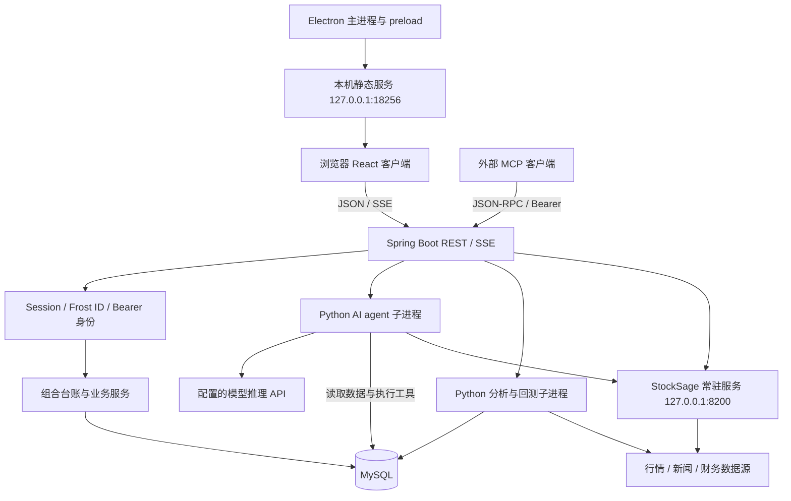

# Investory 当前架构

核对日期：2026-10-20。基于本地工作树源码、依赖清单、路由、构建配置与离线测试；没有访问生产服务器或验证生产运行状态。

## 1. 总体判断

Investory 是一个以投资组合台账为核心的多进程应用：**React 客户端 + Spring Boot 业务后端 + MySQL + Python 分析/采集进程**。Java 代码处于同一个 Maven 模块中，属于带 Python 引擎的单体后端，不是微服务集群。Electron 复用同一套 React 页面，提供窗口、登录回调和自动更新能力。

当前适合归纳为八个逻辑模块。这些是职责划分，不代表已经形成八个独立部署服务。

| 模块 | 主要位置 | 主要职责 | 对外边界 |
| --- | --- | --- | --- |
| 客户端与展示 | `frontend/` | 页面、图表、国际化、设置、聊天、流式反馈 | HTTP JSON、SSE、Electron preload |
| 投资组合与台账 | Java `controller/api`、`service`、`dao` | 组合、持仓、买卖记录、分红、现金、成本、收益、净值、盈亏日历 | `/api/portfolios`、`holdings`、`transactions`、`dividends`、`chart` 等 |
| 行情与数据采集 | Java `crawler`，`script/fetch_*.py` | 实时行情、历史价格、基本面、新闻、汇率、定时采集、管理员控制 | 外部数据源 → MySQL/缓存 → REST/SSE |
| 量化研究与回测 | StockSage Alpha，`analyze_quant.py`、`backtest_engine.py` 等 | 因子、市场状态、选股、组合风格、相关性、策略、回测、滚动验证、调参 | `/api/quant/*`、`stocksage/*`、`backtest/*` |
| AI 助手 | `AiApiController`、`AiSessionManager`、`script/ai_agent.py` | 模型适配、工具编排、会话历史、产物、记忆、用户确认/回答 | `/api/ai/*`、Python stdin/stdout 协议、模型供应商 API |
| 身份与外部集成 | `AuthService`、`web`、OAuth/MCP 控制器 | 本地认证、Frost ID、Session、Bearer token、MCP 工具、确认令牌 | 登录/回调、`/mcp`、`/oauth/mcp/*` |
| 桌面宿主 | `desktop/main.js`、`preload.js` | 本地静态页面、窗口 IPC、系统浏览器、深链接、更新 | `127.0.0.1:18256`、`investory://` |
| 存储与交付基础设施 | MySQL、Flyway、`pom.xml`、Vite、`deploy.py` | 持久化、数据库增量迁移、编译、打包与人工发布工具 | JAR、前端静态资源、Windows 安装包 |

## 2. 运行时关系



- 浏览器版由 Java 提供 Vite 构建产物；开发时也可使用独立 Vite 服务。
- Electron 的静态服务只提供页面，不承载业务 REST API；API 地址由 `frontend/.env.electron` 的 `VITE_API_BASE` 决定。
- Java 与 Python 同时存在三种边界：短任务子进程、可交互 AI 子进程、StockSage 回环 HTTP。它们的生命周期与故障模式不同。
- StockSage `server.py` 使用线程 HTTP 服务和引擎锁；Java 桥接优先请求常驻服务，无法使用时回退 CLI。常驻服务启动/运维仍是单独的运行前提，不能把源码存在当成已运行。
- 示例后端端口为 HTTPS `8443`、context path `/investory`；公网反向代理、开发代理及桌面 API Base 需要与实际配置一致。代码中的 `/api/*` 端点均相对于后端 context path。

## 3. 客户端结构

入口：`frontend/src/main.tsx` → `App.tsx`。登录保护和布局包裹主要页面；部分业务页面通过动态 import 分包。

| 目录/文件 | 作用 |
| --- | --- |
| `pages/` | 仪表盘、持仓、交易、分红、股票详情、盈亏日历、市场、研究、设置、管理员、聊天页面 |
| `features/chat/` | 消息/工具产物类型、Markdown 与行情引用渲染、进程内消息存储 |
| `features/research/` | `RiskSection` 组合因子分析，`BacktestSection` 策略与回测工作区 |
| `providers/` | Auth、Settings、Theme、Confirm、Prompt、I18n 的 Provider 组件 |
| `hooks/` | Context 消费 Hook、异步资源、刷新、通知、动画等可复用逻辑 |
| `services/api.ts` | 大部分 REST 请求和响应类型边界；少量长任务请求仍在页面附近 |
| `types/` | 业务响应、Electron 和语音识别接口 |
| `components/` | 布局、行情引用、图表、通用 UI、通知和动效 |
| `i18n/` | 中英文文案与上下文 |

Provider 与消费 Hook 已拆开，避免组件文件同时导出 Hook/Context 破坏 Fast Refresh 边界。聊天消息通过 `useSyncExternalStore` 订阅；清理前的全局数组加手工触发刷新已替换。

`/quant`、`/watchlist` 是兼容跳转入口，实际工作区分别是 Research、Holdings；被删除的是不再使用的旧页面实现，并没有移除自选股 API 或筛选功能。Research 仍复用 Screener。

异步数据按请求 key 归属，取消的请求不能覆盖后来的结果。组合相关页面在 `portfolioId` 变化时重建，后台预分析缓存按组合分开。聊天、Markdown、行情引用和用户新增的引用 token 协议保留。

`npm run check:imports` 检查从 `main.tsx` 出发的静态 import/export 及字面量动态 import 可达性。目前 72 个应用模块全部可达。此检查不证明每个导出都被使用，也不覆盖运行时资源和全局 `.d.ts`。

## 4. Java 业务层

```text
controller/            HTTP、OAuth、MCP、SPA 入口
controller/api/        REST 参数、身份和响应边界
service/               成本/持仓/盈亏/组合分析、认证、回测执行、MCP 编排
dao/                   JdbcTemplate SQL 与行映射
model/                 业务对象和回测请求
crawler/               调度器、行情服务、长任务与 SSE 会话
util/                  Python 桥接、子进程运行、JSON、拼音
web/                   登录拦截、CORS、异常处理
config/                线程池与 StockSage 桥接装配
```

主要业务服务：

- `HoldingService`、`CostCalculationService`：持仓与成本计算。
- `PnlLedgerService`、`PortfolioValueCalculator`：盈亏台账、组合日净值与回填。
- `PortfolioAnalysisService`：组合层面的展示/分析数据。
- `StockSearchIndexService`：股票搜索索引。
- `BacktestExecutionService`：回测占位、入库、进程、进度解析、结果落库与临时文件清理。

回测控制器不再直接拼装 Python 进程和解析输出；`BacktestRequest` 在 HTTP 边界校验类型和日期。每个用户最多一个活动回测，不同用户的状态、日志和订阅分开。终态事件保留供稍晚连接的客户端读取，日志/事件各保留最多 300 条；历史结果以数据库为准。会话状态仍是内存状态，Java 重启后不会恢复执行现场。

`ProcessRunner` 并发读取输出并独立计时，解决“先阻塞读取、再等待超时”导致超时不生效的问题；目前用于回测和可选标题生成。其他历史 Python 调用点仍需在业务测试充分时逐步统一，不能据此认为全仓库子进程都已采用同一管理器。

## 5. Python 分析、采集与智能体

### 5.1 `script/`：应用侧任务

| 入口 | 职责 |
| --- | --- |
| `fetch_stocks.py` | 各市场股票和历史价格采集 |
| `fetch_fundamentals.py` | 基本面采集，区分正常写入与 dry-run |
| `fetch_news.py` | 新闻抓取与存储 |
| `analyze_quant.py` | 应用组合量化分析 |
| `portfolio_style_analyzer.py` | 持仓风格分析 |
| `optimizer.py` | 组合优化 |
| `backtest_engine.py`、`backtest_helpers.py` | 规则/自定义策略回测、滚动验证、参数搜索 |
| `ai_agent.py`、`agent_message.py` | 模型流、工具执行、消息转换与交互协议 |
| `db.py` | 配置读取、环境变量覆盖、MySQL 连接；不在 import 时连接数据库 |
| `model_transport.py` | 模型端点代理判定与代理配置，与 agent 主循环解耦 |
| `tool_catalog.json` | 工具定义数据 |
| `ai_knowledge_base.json`、`agent_skills/` | 静态知识和任务工作流提示 |
| `evals/` | 智能体行为案例/验证器；区别于离线单元测试 |

Java 启动 AI 子进程后读取 stdout 上的协议事件，`AiSessionManager` 管理用户会话，stdin 用于用户回答等交互。聊天历史、产物和记忆有数据库存储；不是单纯把完整聊天保存在前端内存。

工具可以读取数据库、调用分析、提出待确认的台账修改，以及生成策略。**生成 Python 策略并执行与“模型只生成文字”有不同的能力边界**；现有代码包含过滤/受限执行逻辑，但不等价于操作系统级隔离沙箱。

### 5.2 StockSage Alpha：分析引擎

位置：`backend/src/main/python/stocksage_alpha/`，由 `bridge.py`/`server.py` 暴露命令能力。

- `fetcher.py`、`cache.py`、`trading_calendar.py`：数据获取、缓存、交易日。
- `factors/`：基本面、事件、情绪、技术因子与聚合评分。
- `factors/technical/`：动量、振荡、形态、波动、成交量、市场类因子；`__init__.py` 维持公开导出。
- `strategies/`：策略评分/选股。
- `research.py`、`industry.py`、`report/`：研究、行业和报告构造。

原来的 `factors/technical.py` 与同名 package 同时存在，Python 实际导入 package。旧单文件未被运行路径使用，且与拆分实现大面积重复，已删除；保留的是实际生效的 package，实现和导出未被旧代码覆盖。

两套 Python 位置的区别是“应用任务编排”和“分析引擎”，不建议为了目录整齐把它们机械合并。它们目前仍有数据/指标概念重叠；后续统一应以数据口径测试为先。

## 6. 身份、MCP 与存储

认证以 Spring Session JDBC 和拦截器为主；本地账号及 Frost ID 使用同一业务身份。桌面登录通过系统浏览器完成，再经 `investory://` 深链接拿到一次性 token，交回后端兑换应用自己的 session cookie。测试登录控制器限制在 `test`/`dev` profile。

MCP 在 `McpToolRegistry` 中注册 46 个工具。大部分工具以调用者身份转发现有 REST，写操作先暂存，再通过确认令牌落地。部分工具只返回说明，并不是所有工具都有与内置 AI 完全相同的能力。这里的 create/delete transaction 操作影响**应用台账**，没有券商订单通道。

MySQL 主要承载：账号/组合、股票/价格/基本面、持仓/交易/分红、日净值、策略/回测结果、分析缓存、AI 设置/会话/产物/记忆、MCP token/OAuth 数据、Session、采集历史。StockSage 与 Java/Python 各层也有内存/数据库缓存；因此刷新行为不能仅按前端缓存理解。

显示币种通过 `/api/market/exchange-rates` 读取数据库的外币/CNY 比率，再乘以人民币金额。原汇率表没有更新时间字段，因此接口不声称这些值是实时行情，`updatedAt` 为 null；前端缺值时仍使用原有的备用比率。

迁移存在两个目录：

- `resources/db/migration/V2..V7` 是版本化 Flyway 迁移。
- `resources/db/migrations/2026-*.sql` 是历史增量脚本，不能因为后缀是 SQL 就认定会被默认 Flyway 自动执行。

当前缺少完整 V1 初始业务 schema，示例又采用 baseline-version=1。**只新建一个空数据库并不能保证首次启动成功**。此外，部分表结构由 Java/Python 运行时维护。此次没有修改既有迁移编号、执行 DDL 或改写实际数据库；新环境初始化需要单独以现有 schema 和迁移历史为依据梳理。

## 7. 桌面与构建

- Electron `main.js` 启动回环静态服务，并加载 `www/`；`preload.js` 仅暴露窗口、外链、更新、登录回调等桥接接口。
- 桌面开发/打包脚本已补齐。`build:frontend` 调用前端专用 electron 构建，仍执行类型检查。
- 桌面打包显式使用 `--publish never`；发布配置仍供人工发布流程使用。运行打包脚本不会自动上传版本。
- 桌面源码和必要图标已从笼统忽略规则中豁免，`www/`、依赖和安装包继续忽略。打包后的图标从 `resources/assets` 读取。
- 全局忽略 TLS 证书错误的开关已移除。连接自签名开发后端应正确配置信任，不应把所有 HTTPS 校验永久关闭。
- Maven 的前端构建失败现在会令构建失败，防止把旧页面误打进新的 JAR。
- `deploy.py` 同时包含服务器部署与桌面发布动作，不是无副作用的本地构建工具。本次未运行。

## 8. 验证入口与仍需演进的边界

从仓库根目录运行：

```powershell
npm --prefix frontend run check
npm --prefix frontend run build
npm --prefix desktop run build:frontend
python -X utf8 -m unittest discover -s script/tests -v
mvn -o -f backend/pom.xml '-P!build-windows,!build-unix' test
```

Maven 最后一条用于已有依赖缓存的离线验证，并关闭会自动构建前端的 OS profile；完整发布构建应执行正常前端构建流程。采集集成测试只有设置 `INVESTORY_INTEGRATION_TESTS=true` 才运行，会访问配置的数据库和外部数据源。

当前仍需作为独立业务改造处理的事项：

1. 大型 `AiApiController`/`ai_agent.py` 仍承担协议、业务、存储多重职责；本次先拆出消息、渲染、存储、配置和回测进程边界，没有进行高风险的整套 agent 重写。
2. 部分 Controller 仍直接调用 JdbcTemplate，Java/Python 共享数据库 schema；后续应按用例收敛服务层，不能只做机械包移动。
3. 内存任务状态、定时任务、常驻引擎锁、缓存和固定线程池以单实例为前提；多实例部署需要任务所有权与共享状态。
4. 自定义策略执行没有完成系统级隔离；实盘前需要确定性的信号/风控、独立执行网关、订单状态机和对账。
5. 缺少券商 SDK/QMT/真实订单适配，Electron 不等于完整离线私有化客户端；这些属于未来产品能力。
6. Web 构建仍提示部分图表/主入口包大于 500 kB；功能构建通过，但首屏性能、真实浏览器交互和安装包全链路尚未在本次验证中覆盖。

这些边界不阻止继续以 Investory 开发量化研究工具，但不能把当前台账/回测结果当作已验证的实盘交易系统。
