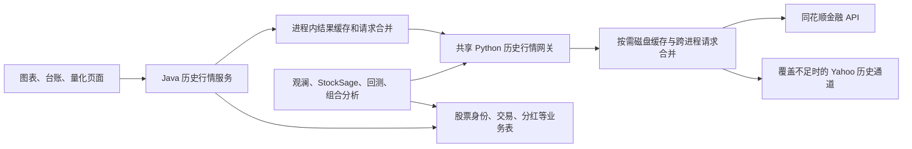

# 历史行情脱离本地价格表

2026-10-24更新：[旧国内行情库退役](../operations/price-retirement-2026-10-24.md)已随v6.3.10部署完成：旧写入和抓取代码已移除，生产国内旧行情17,152,655行已备份后清理，5–10年指数只读归档保留3,651根。下文保留迁移当时的范围与验证记录，关于“保留默认关闭归档写入”的描述已由退役方案替代。

以下正文描述2026-10-23迁移时的实现和验证范围；当前部署状态、实际清理结果及数据回滚步骤以上述退役记录为准。

## 运行路径

统一入口为 `script/market_history.py`。Java 通过有进程树终止能力的 `ProcessRunner` 调用同一个网关，避免 Java 和 Python 各维护一套价格口径。Java 最多并行运行 4 个历史请求，队列上限 128，请求预算 25 秒；失败不写成功缓存。

## 迁移范围

| 功能 | 价格入口与口径 |
|---|---|
| K 线图、股票技术分析、相关性 | 共享历史网关，股票前复权，指数原始点位 |
| 盈亏台账、组合累计收益 | 共享历史网关，不复权；无有效价格时返回失败，不能以成本充当市价 |
| 回测、量化计算、优化器、StockSage | 共享历史网关，前复权；回测要求真实成交量，不能将缺失量补成 0 |
| 观澜历史、相关性、基准、全球指数工具 | 历史网关；组合权重使用行情网关，证券身份仍来自业务库 |
| Java 持仓上下文、问候语 | 共享实时报价；后台问候语仅复用现有缓存，避免额外拉行情 |
| 世界市场最后收盘价备用路径 | 历史网关，非实时标记保留 |
| 管理页统计 | 不再 ANALYZE 或 JOIN 价格表；价格表统计显示空值 |

Java 和活跃 Python 模块不再对 `stock_prices` 发起 SELECT/JOIN。`StockPriceDao` 仅保留默认关闭的归档写入方法；旧读取方法已移除。Java 定时抓取、管理员手动抓取和 Python `fetch_stocks.py` 默认停用。仅归档维护需要时，显式开启 Java 属性 `investory.history.legacy-writes-enabled=true`；直接运行旧 Python 脚本还需 `INVESTORY_LEGACY_HISTORY_WRITES=true`。业务指标计算、新闻同步和台账任务保留。

用户交易、分红、股票身份、汇率、每日组合快照和分析结果仍属于业务库。此次目标是取消对本地 K 线表的依赖，不是移除整个 MySQL。

收益快照重建先完成全部行情计算，再在事务内删除旧快照并写入新快照；数据源失败时保留原有记录，写入失败时回滚。

## 缓存策略

1. Java 内存最多保存 128 个区间，合并同区间并发请求；不同标的不在全局锁内等待网络。
2. Python 按标的、价格口径、年份保存已覆盖区间。不同查询区间共享历史数据，只请求缺口；连续冷缺口合并请求，遵守单次区间限制。
3. 不复权已定稿日线无固定过期时间。为跨时区收盘及数据定稿保留最近两个自然日的可更新窗口，这部分缓存 25 秒。
4. 前复权和后复权存在每日复权周期，跨日重新核验；同一周期内复用重叠历史。避免后续分红送转导致复权历史失真。
5. OS 文件锁协调 Java 子进程及 Python 工具；进程意外终止后操作系统释放锁。同一请求 5 个进程并发时只请求一次上游。跨进程限速只保留短暂的排期锁，不在全局锁中访问网络。
6. 写入采用原子替换；磁盘缓存上限 64 MiB、最多 2048 个数据文件。位置默认为 `~/.cache/investory/history`，可通过 `INVESTORY_HISTORY_CACHE_DIR` 指定服务账户可写目录。缓存可淘汰，不能充当审计记录或用户台账。
7. 上游报错不缓存为成功；整段空结果最多复用一天。已有历史加新缺口的空响应也不能将缺口永久冻结。
8. 缓存来源、命中和过期时间不新增到用户界面。不可用历史通过标准 503 响应提示。

## 覆盖边界

同花顺 A 股历史支持明确指定价格口径，国内指数历史目前仅覆盖近五年，ETF 历史仅提供前复权。缺少的境外、旧指数及 ETF 不复权数据仍需独立网络通道，不能宣称全部由同花顺提供。接口契约参考[官方完整文档](https://fuyao.aicubes.cn/llms-full.txt)。

2026-10-23 的[指数专项复核](hithink-index-audit-2026-10-23.md)确认：官方明确限制近五年；10 个宽基、概念及行业指数的近期日线均可获取，上证近五年返回1206根，2019年样本为空。指数目录和当前成分股接口也已直连验证。注意官方示例的 `886042.TI` 当前目录名称为存储芯片，白酒概念为 `885525.TI`，应以动态代码目录为准。

Yahoo OHLC 默认受拆股归一化影响。账务使用时拉取截至当前的后续拆股事件，将价格和成交量还原至对应交易日口径；前复权使用其调整收盘价因子。此处依赖供应商事件完整性，并未加入本次范围之外的自动持仓除权记账。

冷数据首次加载仍依赖网络、供应商覆盖和额度。缓存提高重复访问性能，不能替代上游可用性保证。此前实时行情故障测试发现的 `RealtimeQuoteService` 全局 I/O 锁属于实时报价路径，本次未修改，不能据本次历史缓存测试声称该问题已解决。

## 验证记录

- H2 测试不创建 `stock_prices`，实际运行图表、基准比较、持仓上下文、相关性、问候语及收益台账；价格供应商使用确定性夹具。缺价台账必须失败。
- 真实 Java → Python → 同花顺 → 图表链路也在无行情表的 H2 夹具下通过。
- Python 测试覆盖历史重叠补齐、跨日复权周期、最近两天刷新、失败恢复、空缺口重试、5 线程及 5 进程请求合并、拆股还原、优化器日期交集和禁止价格表 SQL。
- 真实只读抽样共 7 组：贵州茅台不复权/前复权、上证指数、沪深 300 ETF 前复权/不复权、腾讯不复权、苹果 2020 年拆股区间不复权。均返回有效行情；前四组由同花顺提供，后三组为 Yahoo 备用覆盖。
- 同区间暖缓存约 6.6–8.3 毫秒。首次实测约 139–1256 毫秒；这是本机抽样，不能视作线上 SLA。
- 同花顺 2024 年贵州茅台前复权全年查询与上半年查询重叠 117 根收盘价，最大差异为 0，验证当前接口复权锚点不随请求结束日改变。
- 使用真实同花顺日线完成本地高级回测：30 个交易日、21 条模拟交易日志，行情输入摘要写入回测指标内。没有连接券商或发出实际交易。

最终回归：Java 125 项中 118 通过、7 项环境条件跳过；真实 Java 历史链路另行启用并通过。Python 80 项通过；前端类型、lint、导入检查通过，对话回归 8 项通过；观澜 smoke 28 项通过、15 项需完整模型环境而跳过。Maven 本地打包通过。

外部验证产物位于 `D:/Attention/reports/history-gateway-2026-10-23/`。现有数据库保留用于回滚及上线观察，是否归档删除另行决定。
